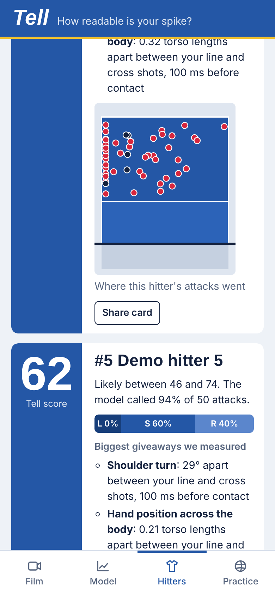
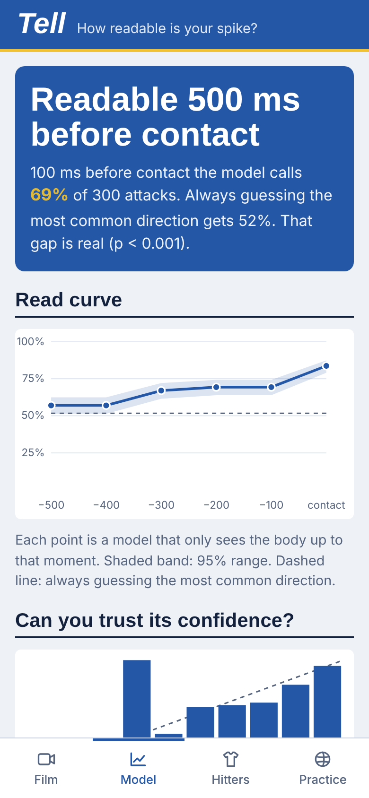
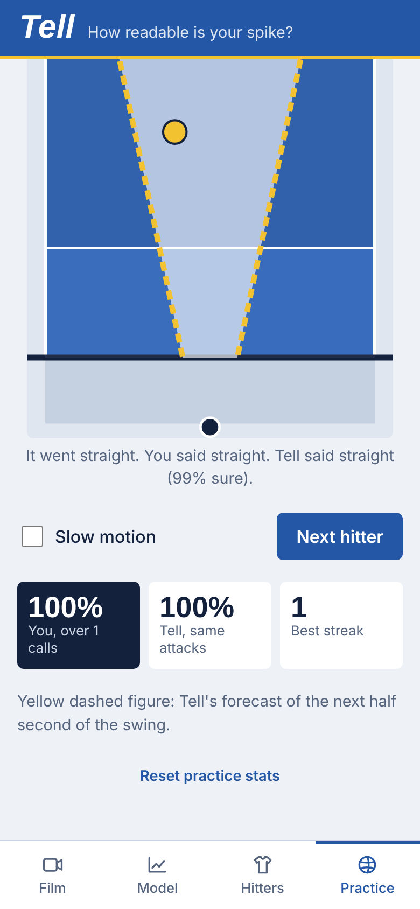

# Tell

**How readable is your spike?** Film a volleyball match on your phone and tag the attacks. Tell watches each hitter's approach and arm swing and predicts where the ball is going *before contact*. Every hitter gets a **tell score**: how much the model's read narrows down their shot.

Liberos and blockers can use the same model as a reading drill. Watch a hitter's swing freeze before contact, call the shot, and see if you beat the model.

<p align="center">
  
  
  
</p>

> The screenshots and numbers below come from **synthetic demo data** with tells planted on purpose. They show what the app does, not how readable real players are. That's what the first two weeks of filming are for ([plan](docs/PLAN.md)).

## What it does

1. **Film.** Phone behind your end line, sideways, as high as you can get.
2. **Tag.** Pause on contact, tap the hitter, tap where the ball went. Pose tracking (MediaPipe) runs on the phone over a 1.5 s window around each contact and follows the player you tapped.
3. **Model.** Trains in the browser in a few seconds and scores itself on matches it hasn't seen. You get:
   - a **read curve**: accuracy at 0–500 ms before contact, against always guessing the most common direction
   - a check of whether its confidence can be trusted (calibration error)
   - a **world model** check: how well it forecasts the hitter's next 0.5 s of movement
4. **Hitters.** A tell score from 0 to 100 for each hitter, with a likely range, shot distribution, landing map, and the body cues that differ most between their shots ("shoulder turn: 37° apart between your line and cross shots, 100 ms before contact"). Share cards are sized for stories.
5. **Live.** Point the phone camera at the court. Tell tracks the hitter in real time, shows its call (line, cross…) with confidence as they swing, and draws the world model's forecast of their next half second as a yellow ghost skeleton. When the arm swing finishes it captures the swing automatically. Tap where the ball went and it's saved as training data, with an instant "Tell read it / missed it". No video is recorded.
6. **Practice.** A skeleton replay that freezes before contact. Call the shot, then see the answer, the model's call, and its forecast of the rest of the swing. Get three right and it freezes earlier.

Videos never leave the phone. Tell stores skeletons and tags only, in the browser's storage. Install it to your home screen and it works offline in a gym.

## How the model works

- **Features** come from MediaPipe *world* landmarks (metric, hip-centered): shoulder and hip turn, hip-shoulder separation, lean, hitting-arm angles, hand position, head turn, and the approach path. Left-handed hitters are mirrored so one model reads both hands.
- **On the phone:** calibrated logistic regression (or a small MLP) on a 10-frame window ending at the cutoff, plus a linear world model (PCA + autoregression) that forecasts pose without needing any labels.
- **On a laptop** (`ml/`): an LSTM baseline (the tennis approach) and **RallyWorld**, a causal transformer that predicts the next 0.5 s of pose, a landing-spot mixture, and the shot direction from every frame. It exports to ONNX.
- **Evaluation:** folds grouped by match, temperature scaling fit only on training data, an exact binomial test against the majority baseline, and tell score = 100 × information gain over base rates (McFadden-style), with bootstrap ranges.

Prior work in tennis, badminton and table tennis, and what Tell borrows from each, is in [docs/PRIOR_ART.md](docs/PRIOR_ART.md).

## Results on synthetic data

Six made-up hitters with planted tell strengths of 0.9, 0.7, 0.6, 0.35, 0.15 and 0. Scored on held-out matches.

**300 attacks, 5 matches** (the first-two-weeks scale):

| Cutoff before contact | contact | 100 ms | 200 ms | 300 ms | 400 ms | 500 ms |
| --- | --- | --- | --- | --- | --- | --- |
| Logistic (app) | **83.7%** | **65.0%** | **66.7%** | **63.0%** | **57.0%** | 55.7% |
| LSTM | 65.3% | 62.3% | 60.7% | 55.7% | 48.0% | 45.0% |
| RallyWorld | 64.0% | 63.3% | 63.0% | 58.0% | 49.7% | 44.7% |
| Always guess most common | 51.7% | 51.7% | 51.7% | 51.7% | 51.7% | 51.7% |

**900 attacks, 15 matches:**

| Cutoff | contact | 200 ms | 400 ms |
| --- | --- | --- | --- |
| Logistic | **85.6%** | 68.7% | **63.1%** |
| RallyWorld | 74.6% | **71.2%** | 56.0% |
| Always guess most common | 46.4% | 46.4% | 46.4% |

What this says: at a few hundred attacks the small model is the right one, which is why the app uses it. The transformer improves fast with more data and passes the small model at 200 ms by 900 attacks. That's the case for collecting club data at scale.

The tell scores mostly come out in the planted order. The hitters with strengths 0.9, 0.7 and 0.6 score 62–66. The 0.35 hitter scores 15, and the two weakest score 0 and 9, with ranges that overlap, so the app can't tell those two apart at 50 attacks each. A test that shuffles labels at random checks the pipeline doesn't invent tells (information gain stays under 5%). The world model's 0.5 s pose forecast has about half the error of assuming the hitter freezes.

## Public data

There is no public volleyball dataset with attack-direction labels. The ones on Hugging Face cover whistles, rally/no-rally clips, action frames and player tracking, and pro datasets like Ibrahim et al. label actions, not where the ball went. Tell builds its own: every tagged video attack and every live-captured swing becomes a labeled example.

## Run it

```bash
npm install
npm run dev          # http://localhost:5173, then Film > Load demo data
npm test             # engine tests: geometry, stats, features, end-to-end on synthetic data
npm run build
```

Desktop training pipeline:

```bash
cd ml && pip install -e ".[dev,extract,export]"
npm --prefix .. run export-demo -- ml/data/demo.json
python -m tell.train data/demo.json          # logreg, LSTM, RallyWorld; prints the tables above
pytest -q                                     # includes a TypeScript/Python feature parity test
```

More in [ml/README.md](ml/README.md). The export format is in [docs/DATA_FORMAT.md](docs/DATA_FORMAT.md).

## Layout

```
src/lib/        features, court geometry, pose tracking, live camera buffer + contact detection, synthetic data
src/lib/ml/     classifiers, cross-validation, calibration, tell score, world model
src/screens/    Film (matches, roster), Tag (video tagging), Live (camera), Model, Hitters, Practice
ml/tell/        Python port of the features, LSTM + RallyWorld, training, extraction, ONNX export
docs/           prior art, data format, plan
```

## Filming other people

Get permission from players before filming, and from parents for anyone under 18. Tell keeps video on the device, but exports and share cards still name players.

MIT licensed.
